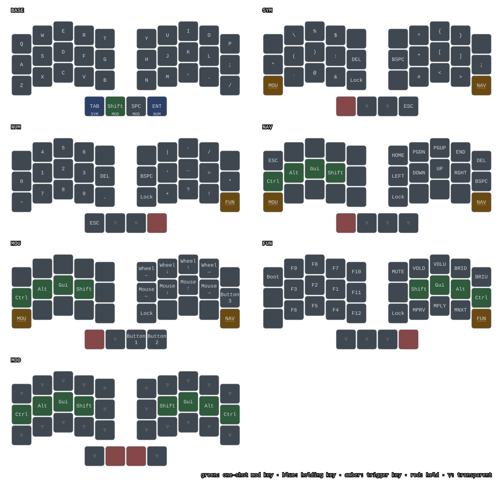

# PROTOTYPE: the keymap image in a README on GitHub

Throwaway. This page exists to see how the image reads on GitHub in the light and in the dark theme.

## The file that would be committed (`dark_mode: auto`)

It follows the `prefers-color-scheme` of the browser.

## Fixed light colours

## Fixed dark colours

