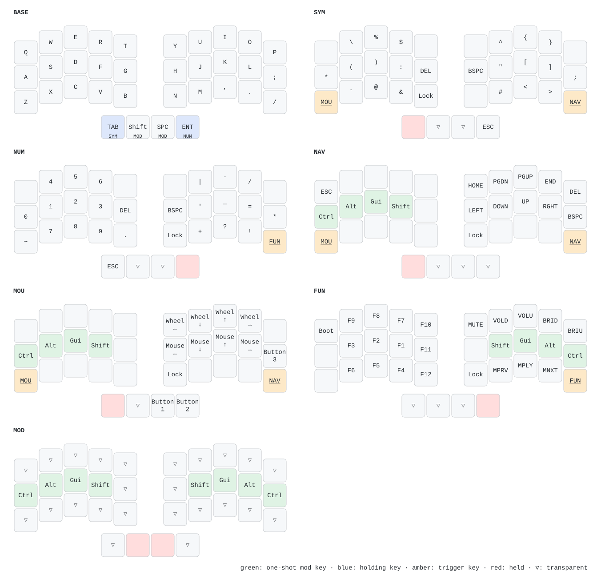

# The `hydeik` keymap family

A typing design for 34 keys: three rows of ten finger keys and four thumb keys. It has no home-row mods. Modifiers are one-shot mods, chosen on a smart mod layer that lies over the home row, and the layers beyond symbols and numbers are reached with a holding key and a trigger key.

This directory holds the keymap family for every keymap of it, with and without Vial. The terms used here are defined in [`GLOSSARY.md`](../../GLOSSARY.md), and the decisions behind the design are recorded in [`docs/adr/`](../../docs/adr/): [ADR 0002](../../docs/adr/0002-hydeik-vial-one-shot-mods-are-an-own-state-machine.md) for the one-shot mods, [ADR 0003](../../docs/adr/0003-layer-switching-is-one-state-machine-in-the-common-core.md) for the layer switching and [ADR 0004](../../docs/adr/0004-one-keymap-family-built-with-and-without-vial.md) for the one directory. How to build and test is in the [README of the repository](../../README.md).

## Layers

There are seven layers, defined in [`layout.h`](layout.h). The number is the layer number in the firmware keymap.

| # | Layer | Holds | Reached by |
| --- | --- | --- | --- |
| 0 | BASE | QWERTY, with the two holding keys and two smart mod layer keys on the thumbs. | It is the default layer. |
| 1 | SYM | Symbols and brackets, Delete, Backspace, Esc, Layer Lock, and the trigger keys of MOU and NAV. | Holding `TAB_SYM`. |
| 2 | NUM | The digits in three rows on the left hand, arithmetic and punctuation symbols on the right, Delete, Backspace, Esc, Layer Lock, and the trigger key of FUN. | Holding `ENT_NUM`. |
| 3 | NAV | Arrow keys, Home, End, Page Up and Page Down on the right hand, one-shot mod keys on the left home row, Esc, Delete, Backspace, Layer Lock, and the trigger keys of MOU and NAV. | The trigger key of NAV while `TAB_SYM` is held. |
| 4 | MOU | Mouse keys: the pointer on the right home row, the wheel above it, three buttons; one-shot mod keys on the left home row, Layer Lock, and the trigger keys of MOU and NAV. | The trigger key of MOU while `TAB_SYM` is held. |
| 5 | FUN | F1 to F12 on the left hand, volume, brightness and media keys on the right, one-shot mod keys on the right home row, the bootloader key, Layer Lock, and the trigger key of FUN. | The trigger key of FUN while `ENT_NUM` is held. |
| 6 | MOD | The smart mod layer: one-shot mod keys on both home rows, every other key transparent. | Holding a smart mod layer key, `SMT_MOD` or `SPC_MOD`. |

The keymap image shows the firmware keymap. It is generated from `layout.h`, which is the source of the layers. Its footer explains the colours, which mark the one-shot mod keys, the holding keys, the trigger keys and the held keys, which are the keys that keep the layer on and carry no legend. `▽` is a transparent key, and every other key without a legend does nothing. The comments of `layout.h` still hold a diagram of every layer. How to regenerate the keymap image is in the section [Keymap image](../../README.md#keymap-image) of the README of the repository.

### BASE

The four thumb keys, from left to right:

| Key | Tapped | Held |
| --- | --- | --- |
| `TAB_SYM` | Tab | Holding key of SYM. |
| `SMT_MOD` | Shift as a pending one-shot mod; see [below](#one-shot-mods-and-the-smart-mod-layer). | Smart mod layer key. |
| `SPC_MOD` | Space | Smart mod layer key. |
| `ENT_NUM` | Enter | Holding key of NUM. |

All four are layer-tap keys. With Hold On Other Key Press, each is held as soon as another key is pressed while it is down, without waiting for the tapping term of 200 ms.

### MOU

The pointer is on the home row in Vim order (left, down, up, right) and the wheel above it in the same order. The left and the right button are on the right thumb keys and the middle button is on the pinky. Mouse Keys are switched on for every keymap of the family in [`rules.mk`](rules.mk).

## Layer switching

SYM and NUM are holding layers: each is on while its holding key is held. NAV, MOU and FUN are target layers. A trigger key, pressed while its holding key is held, switches to its target layer. The table of entries is in [`hydeik.c`](hydeik.c):

| Holding key | Holding layer | Trigger key | Target layer | Quick release of the holding key |
| --- | --- | --- | --- | --- |
| `TAB_SYM` | SYM | `TRG_NAV`, the bottom-right corner | NAV | NAV becomes a locked target layer. |
| `TAB_SYM` | SYM | `TRG_MOU`, the bottom-left corner | MOU | MOU becomes a locked target layer. |
| `ENT_NUM` | NUM | `TRG_FUN`, the bottom-right corner | FUN | FUN becomes a pending target layer. |

The corners are those of the bottom row of finger keys, the positions of `Z` and `/` on BASE.

- The target layer stays on until the holding key is released. The trigger key may be released at any time.
- Pressing the trigger key again switches the target layer off, and the trigger key of another target layer replaces it. NAV and MOU hold the trigger keys of both, at the same corners as SYM, so the one can be swapped for the other while `TAB_SYM` is held.
- A quick release is the release of the holding key less than the One Shot Term of 200 ms after the press of the trigger key, with no key typed in between.
- A locked target layer stays on until its trigger key or Layer Lock unlocks it. Every target layer holds its own trigger key at the corner that switched to it, so the same key enters and leaves it. Layer Lock unlocks by itself when the keyboard is idle for 60 seconds.
- A pending target layer stays on for the next typed key only. Its trigger key switches it off, holding a holding key ends it, and it ends after 2 seconds; the time is counted anew at every press and release of a one-shot mod key, and not at all while a smart mod layer key is held.
- A trigger key without its held holding key does nothing, except to switch off its own target layer when that is locked or pending.
- Layer Lock, on every layer but BASE and MOD, locks the highest layer that is on. Pressed on a target layer that is held or pending, it makes it a locked target layer.

The rules in full are in [`features/target_layer.h`](features/target_layer.h).

## One-shot mods and the smart mod layer

The one-shot mod keys are custom keycodes of the family, `COS_LCTL` to `COS_RGUI`, one for each modifier on each side. They are not QMK's built-in one-shot mods.

- Held, a one-shot mod key is an ordinary modifier.
- Tapped, that is, released within the One Shot Term of 200 ms with no other key pressed in between, it leaves a pending one-shot mod. The next typed key consumes all pending one-shot mods. Other one-shot mod keys, ordinary modifier keys and keys that only switch layers do not, so several can be collected and carried to another layer.
- Pressing the same one-shot mod key again cancels its pending one-shot mod, and after 2 seconds all of them are cleared.

One-shot mod keys lie on the home rows of NAV, MOU and FUN, and on the smart mod layer:

- Holding a smart mod layer key, `SMT_MOD` or `SPC_MOD`, turns the smart mod layer on, with one-shot mod keys over both home rows.
- A one-shot mod key pressed and released there leaves a latched one-shot mod: the modifier stays registered, for every key and without a timeout.
- Once all one-shot mod keys are up, the smart mod layer switches itself off, so the keys beneath it are typed with the latched one-shot mods.
- Releasing the last held smart mod layer key releases them all. If no key was typed and the release comes within 400 ms of the press of the last one-shot mod key, they become pending one-shot mods instead.

A tap of `SMT_MOD` makes Shift a pending one-shot mod, or cancels all pending one-shot mods if there are any. A second tap within the tapping term turns Caps Word on. A tap of `SPC_MOD` is Space.

A third smart mod layer key, `ENT_MOD` (Enter when tapped), is defined and placed on no layer; it is there for a stored keymap edited in the Vial GUI.

The rules in full are in [`features/smart_mod.h`](features/smart_mod.h).

## Indicators

On a keyboard with RGB lighting, which is the crkbd with either keymap, an indicator is a light on a key that shows a state of the one-shot mods or of the layer switching. It is drawn over the ordinary lighting effect, on both halves.

| Indicator state | Colour | Motion | Brightness |
| --- | --- | --- | --- |
| Pending one-shot mod | Orange | Blinks | Full |
| Latched one-shot mod | Magenta | Steady | Full |
| Trigger key that works now | Blue | Steady | Dim |
| Target layer that is on | Green | Steady | Full |
| Pending target layer | Cyan | Blinks | Full |
| Locked target layer | White | Steady | Full |

- A one-shot mod is shown at its one-shot mod key, on whichever layer that key lies.
- A trigger key that works is shown where a press now gives that trigger key, while its holding key is held.
- A target layer that is on, pending or locked is shown at its trigger key and at its holding keys.
- A key shows one indicator state at a time: a target layer wins over a one-shot mod, and that over a trigger key that works. The rules in full are in [`features/indicator.h`](features/indicator.h).
- A blink is 400 ms lit and 400 ms dark, in step on both halves.
- The brightness of the indicators is fixed and does not follow the brightness that is set for the ordinary effect. While any indicator is shown, the ordinary effect is dimmed to a quarter on the whole keyboard.

The lighting itself:

- **Both keymaps start with a black background**: RGB Matrix on, with a solid colour at brightness 0, so only the indicators are lit. These defaults are in [`config.h`](config.h). They are written when the EEPROM is initialised, not when a firmware is flashed, so a keyboard that already has stored settings keeps them until its EEPROM is reset.
- **Off stays off.** While RGB Matrix is switched off, no indicator is shown. For indicators without a background, keep an effect on and set its brightness to 0.
- **Nothing is shown on suspend.** While the host sleeps, every LED is off.
- **With Vial**, the effect, its colour and its brightness are changed in the Vial GUI.
- **Without Vial, the settings are fixed at build time.** No layer has a keycode that changes them. To change one, edit the default in `config.h`, flash, and reset the EEPROM with Bootmagic.
- **Four effects are not built**: Raindrops, Jellybean Raindrops, Pixel Rain and Digital Rain. An indicator cannot be drawn right over them. With Vial they are missing from the list of effects.

That the master half decides every indicator state and sends it to the other half is recorded in [ADR 0005](../../docs/adr/0005-the-master-half-decides-every-indicator-state.md).

## With and without Vial

The keymap `hydeik` is the keymap family without Vial and `hydeik_vial` the keymap family with Vial. Both have the layers and the behaviour described above. The keymap with Vial has in addition:

- **Remapping in the Vial GUI.** The GUI edits the stored keymap, which starts as a copy of the firmware keymap. It has eight layers, one more than the firmware keymap fills. The one-shot mod keys are offered there as custom keycodes, which the `vial.json` of the keymap names.
- **Tap-hold settings in the Vial GUI.** They are Vial settings. The `TAPPING_TERM` of [`config.h`](config.h) is only the value a settings reset gives the tapping term, and the `HOLD_ON_OTHER_KEY_PRESS` of `config.h` is ignored. After a settings reset at boot, `firmware_default` switches Hold On Other Key Press back on, because layer switching needs it. A reset asked for from the host while the keyboard runs leaves it off; see [`features/firmware_default.h`](features/firmware_default.h).
- **Combos and tap dances**, for use from the Vial GUI. The firmware defines none.

The stored keymap does not outlive a build: on its first boot, every newly built firmware resets the stored keymap to the firmware keymap, and the Vial settings with it. What was edited in the Vial GUI is lost whenever a new build is flashed, so a change that is meant to last belongs in `layout.h`.

A keymap without Vial types with the firmware keymap. It has no stored keymap, no combos and no tap dances, and its tap-hold settings are those of `config.h`.

What exists only with Vial is chosen in `rules.mk`, by whether the keymap enables Vial. No C source branches on Vial.

## Files

| Path | Contents |
| --- | --- |
| [`rules.mk`](rules.mk) | The build settings, and the choice of what exists only with Vial and of what exists only with RGB Matrix. |
| [`config.h`](config.h) | The settings, among them the tap-hold settings of a keymap without Vial and the defaults of RGB Matrix. |
| [`layout.h`](layout.h) | The layer numbers, the custom keycodes and the 34 keys of every layer, with the diagrams. |
| [`hydeik.h`](hydeik.h) | The header that a `keymap.c` includes. |
| [`hydeik.c`](hydeik.c) | The glue between QMK and the two state machines: which keys are one-shot mod keys and smart mod layer keys, the table of entries, and the QMK hooks. |
| [`typing_rules.c`](typing_rules.c) | Which keys continue Caps Word and what the Repeat Key remembers. |
| [`vial_hooks.c`](vial_hooks.c) | The QMK hooks that exist only with Vial. |
| [`rgb_matrix_hooks.c`](rgb_matrix_hooks.c) | The QMK hooks that draw the indicators: how each indicator state looks, and the sending of the view to the other half. Built only with RGB Matrix. |
| [`features/smart_mod.h`](features/smart_mod.h), `.c` | The state machine of the one-shot mods and the smart mod layer. |
| [`features/target_layer.h`](features/target_layer.h), `.c` | The state machine of the layer switching. |
| [`features/key_typed.h`](features/key_typed.h), `.c` | What counts as a key typed, for both state machines. |
| [`features/indicator.h`](features/indicator.h), `.c` | The logic of the indicators: the indicator state of every key position. Built only with RGB Matrix. |
| [`features/firmware_default.h`](features/firmware_default.h), `.c` | The firmware defaults of the Vial settings. Built only with Vial. |
| [`keyboards/`](keyboards/) | One layout adapter per keyboard, which places the 34 keys of a layer in the layout of that keyboard: `crkbd_rev4_1_mini.h` and `mothwing.h`. The crkbd has two keys more on the inner top row, which enter the bootloader on every layer. |
| [`image/`](image/) | The keymap image, `keymap.svg`, with the script that writes it, the configuration of the script and its unit tests. See [Keymap image](../../README.md#keymap-image). |
| [`tests/`](tests/) | The unit tests, one directory per test. See [Unit tests](../../README.md#unit-tests). |

The keymaps themselves are in `keyboards/<keyboard>/keymaps/<keymap>/` at the top of the repository. Each `keymap.c` includes `hydeik.h` and the layout adapter of its keyboard, and places the seven layers.
